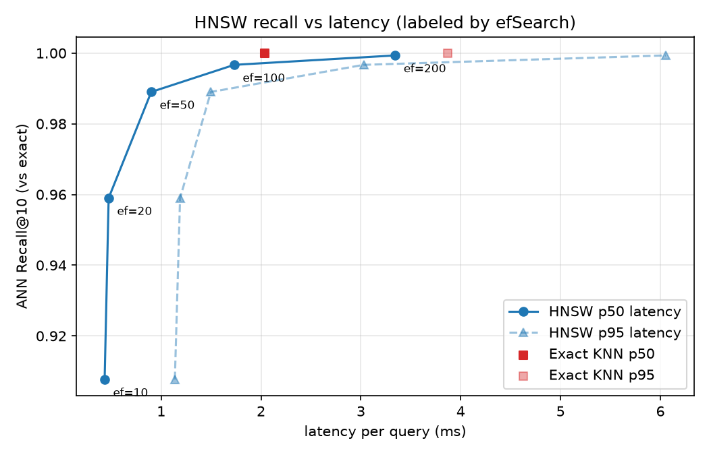

# RetrievalLab-Hybrid-Information-Retrieval-Engine
Built a search engine implementing BM25 inverted indexing, HNSW approximate nearest-neighbor search, reciprocal-rank fusion and cross-encoder reranking. Developed an evaluation framework comparing sparse, dense and hybrid retrieval using Recall@K, MRR, nDCG and latency benchmarks, with an interactive dashboard for inspecting retrieval behavior.

Everything the retrieval stack depends on is written from scratch in this repo: the inverted index, BM25
scoring, cosine similarity and exact KNN, the HNSW graph, the fusion methods, and the evaluation metrics.
Only the embedding model and the cross-encoder come from existing libraries.

## Pipeline

```
                        Query
                          |
            +-------------+--------------+
            v                            v
   Custom BM25 (inverted index)   Dense retrieval (MiniLM embeddings)
                                  exact KNN  |  our HNSW graph
            |                            |
            +-------------+--------------+
                          v
        Fusion: RRF | weighted RRF | normalized score fusion
                          v
              Cross-encoder reranker (optional)
                          v
                     Ranked documents
```

## Results

All numbers are on [BEIR SciFact](https://github.com/beir-cellar/beir): 5,183 scientific abstracts
(split into 19,339 chunks of 500 characters, 50 overlap) and 300 labeled test queries. Single thread, CPU.
Quality is measured at the document level; chunk results are collapsed to their best chunk per document.
The full tables are in [results/](results/).

### 1. BM25 vs exact dense search

| Retrieval | Recall@10 | MRR@10 | nDCG@10 | p95 latency | Index size |
|---|---|---|---|---|---|
| BM25 (k1=1.5, b=0.75) | 0.756 | 0.589 | 0.624 | 6.2 ms | 6.5 MB |
| Dense exact (all-MiniLM-L6-v2) | 0.809 | 0.633 | 0.673 | 23.5 ms* | 29.7 MB |

\*includes embedding the query. BM25 is the stronger choice on speed, size and build time (0.5 s vs 400 s
to embed the corpus); dense retrieval is about 5 points better on nDCG.

### 2. HNSW (from scratch) vs exact KNN

M=16, efConstruction=200, cosine. ANN recall = overlap of HNSW's top-10 with the exact top-10. Vector search
only (queries are pre-embedded).

| Search | ANN Recall@10 | p50 | p95 | Queries/sec | Build | Memory |
|---|---|---|---|---|---|---|
| Exact KNN | 1.000 | 2.04 ms | 3.87 ms | 443 | - | 29.7 MB |
| HNSW ef=10 | 0.908 | 0.43 ms | 1.14 ms | 1922 | 139 s | 49.9 MB |
| HNSW ef=20 | 0.959 | 0.47 ms | 1.19 ms | 1755 | 139 s | 49.9 MB |
| HNSW ef=50 | 0.989 | 0.90 ms | 1.50 ms | 989 | 139 s | 49.9 MB |
| HNSW ef=100 | 0.997 | 1.73 ms | 3.03 ms | 497 | 139 s | 49.9 MB |
| HNSW ef=200 | 0.999 | 3.34 ms | 6.05 ms | 260 | 139 s | 49.9 MB |



**Reading this honestly:** the graph delivers the expected recall/latency trade-off (ef=20 gives 0.96 recall at
about 4x the throughput of exact search). But at ef=100 and above it is no faster than brute force. At 19k vectors,
exact search is a single NumPy matrix multiply, which is very hard to beat, and this HNSW is pure Python. HNSW's
advantage is that its cost grows roughly logarithmically with corpus size while brute force grows linearly,
so it should pay off at much larger scale. This repo does not demonstrate that scale.
It also costs about 1.7x the memory and 139 s to build.

### 3. Hybrid retrieval

BM25 + our HNSW, top 100 documents from each. Fusion settings (RRF k, weights, alpha) were **tuned on SciFact's
separate train queries** and evaluated on the test queries, so tuning does not leak into the scores.

| Method | Recall@5 | Recall@10 | MRR@10 | nDCG@10 |
|---|---|---|---|---|
| BM25 | 0.677 | 0.756 | 0.589 | 0.624 |
| Dense (exact) | 0.723 | 0.809 | 0.633 | 0.673 |
| Dense (HNSW) | 0.723 | 0.809 | 0.633 | 0.673 |
| RRF (k=60) | 0.743 | 0.814 | 0.643 | 0.680 |
| Weighted RRF (tuned: k=10, BM25 0.3 / dense 0.7) | 0.749 | 0.827 | 0.657 | 0.695 |
| Score fusion (tuned: alpha=0.6) | 0.759 | 0.829 | 0.657 | 0.694 |

Fusion beats either retriever alone, by about +0.7 nDCG points untuned and +2.2 points tuned over dense search.
HNSW at ef=100 retrieves the same candidates as exact search, so swapping it in costs no quality here.
End-to-end hybrid latency (including query embedding): p50 29 ms, p95 42 ms.

### 4. Cross-encoder reranking

Reranker: `cross-encoder/ms-marco-MiniLM-L-6-v2` over the top N hybrid candidates. **Measured on a 40-query
sample** because the cross-encoder runs at roughly 10 pairs/second on this CPU.

| System | nDCG@10 | MRR@10 | p95 latency |
|---|---|---|---|
| Hybrid (RRF) | 0.805 | 0.783 | 48 ms |
| Hybrid + reranker (top 10) | 0.785 | 0.755 | 1,165 ms |
| Hybrid + reranker (top 20) | 0.779 | 0.747 | 2,312 ms |
| Hybrid + reranker (top 50) | 0.771 | 0.744 | 6,089 ms |
| Hybrid + reranker (top 100) | 0.771 | 0.744 | 10,485 ms |

**On this setup reranking did not help**: nDCG fell 2 to 4 points while latency rose from tens of milliseconds
to seconds. With 40 queries a difference this size is within noise (6 queries improved, 8 got worse, 26 unchanged),
so the fair conclusion is "no evidence of a gain", not "reranking hurts". A likely reason is domain mismatch:
this model is trained on web search passages, while SciFact is scientific claim retrieval. A full 300-query run
(`python -m searchlab.rerank_benchmark`) takes roughly an hour on this machine.

## Run it

Requires Python 3.10+. From the project root, using a virtual environment:

```powershell
python -m venv .venv
.venv\Scripts\python.exe -m pip install -e ".[dev]"

# Download the benchmark dataset (not committed)
Invoke-WebRequest https://public.ukp.informatik.tu-darmstadt.de/thakur/BEIR/datasets/scifact.zip -OutFile datasets\scifact.zip
Expand-Archive datasets\scifact.zip -DestinationPath datasets

.venv\Scripts\python.exe -m pytest                       # 171 tests, no model downloads or API key needed
.venv\Scripts\python.exe -m searchlab.demo "your query"  # BM25 vs dense side by side
```

The first run that touches the models downloads them, and the first corpus embedding takes several minutes on CPU
(it is cached in `.cache/` afterwards, as is the HNSW graph).

Experiments (each writes a report to `results/`):

```powershell
.venv\Scripts\python.exe -m searchlab.benchmark          # BM25 vs exact dense
.venv\Scripts\python.exe -m searchlab.hnsw_benchmark     # HNSW vs exact KNN (+ graph)
.venv\Scripts\python.exe -m searchlab.hybrid_benchmark   # BM25 / dense / RRF / weighted RRF / score fusion
.venv\Scripts\python.exe -m searchlab.rerank_benchmark --max-queries 40 --latency-queries 10
```

Dashboard (two terminals):

```powershell
.venv\Scripts\python.exe -m uvicorn searchlab.api:app --port 8765
.venv\Scripts\python.exe -m streamlit run src/searchlab/dashboard.py
```

The dashboard shows BM25, dense, hybrid and hybrid + reranker side by side with scores and latency, and lets
you change top-K, BM25 `k1`/`b`, HNSW `efSearch`, exact vs HNSW, fusion method, RRF `k`, weights, alpha, and
reranking on/off. The "Ask (RAG)" tab answers a question with numbered citations and flags unsupported sentences
(needs the LLM `.env` described below). The last tab shows the experiment tables and the recall-vs-latency graph. The API is
configurable with `SEARCHLAB_DATASET` (default `datasets/scifact`); the dashboard with `SEARCHLAB_API_URL`.

## Code map

| Piece | File |
|---|---|
| Config, data models, loaders, cleaning, chunking | `config.py`, `models.py`, `loaders.py`, `cleaning.py`, `chunking.py` |
| Tokenizer, inverted index (postings, TF, DF, IDF) | `tokenizer.py`, `index/inverted_index.py` |
| BM25 | `retrieval/bm25.py` |
| Embeddings, cosine similarity, exact top-K | `retrieval/dense.py` |
| HNSW graph (layers, greedy + beam search, neighbor selection) | `index/hnsw.py`, `retrieval/hnsw_retriever.py` |
| RRF, weighted RRF, score fusion, hybrid retriever | `retrieval/fusion.py`, `retrieval/hybrid.py` |
| Cross-encoder reranker | `retrieval/reranker.py` |
| Metrics (Recall, Precision, MRR, nDCG, Hit Rate) and dataset loader | `evaluation/metrics.py`, `evaluation/dataset.py` |
| Engine, API, dashboard | `engine.py`, `api.py`, `dashboard.py` |
| Chunking strategies and experiment (Phase 7) | `chunkers.py`, `chunking_benchmark.py` |
| LLM client, query transformations, experiment, harm analysis (Phases 6, 10) | `llm.py`, `query_transform.py`, `query_benchmark.py`, `rewrite_analysis.py` |
| RAG answers with citations and grounding check (Phase 8) | `rag.py` |
| Multi-dataset benchmark and failure analysis (Phase 9) | `multi_benchmark.py` |

## Status

| Phase | |
|---|---|
| 1. BM25 + exact dense + evaluation | done |
| 2. HNSW from scratch | done |
| 3. Hybrid search (RRF, weighted RRF, score fusion) | done |
| 4. Cross-encoder reranking | done (measured on a 40-query sample) |
| 5. FastAPI + Streamlit dashboard | done |
| 6. Query rewriting, HyDE, expansion | code and tests done; experiment not run yet (needs an LLM key) |
| 7. Chunking experiments | code and tests done; experiment partly run (see below) |
| 8. RAG answer layer | done and tested with a stub LLM (`/answer` endpoint, Ask tab); not yet tried with a real LLM |
| 9. Multi-dataset benchmarking and failure analysis | code and tests done; experiment not run yet |
| 10. Research extension: when does query rewriting hurt? | code and tests done; needs the Phase 6 results first |

No results are reported for phases 6 to 10 because none have been measured yet.

### Finishing phases 6 to 10

```powershell
# 1. Phase 7 (about 45 minutes of CPU). The `fixed` strategy is already embedded and cached.
.venv\Scripts\python.exe -m searchlab.chunking_benchmark

# 2. Phase 9: SciFact + NFCorpus. Run it alone, since it measures latency (NFCorpus is already downloaded).
.venv\Scripts\python.exe -m searchlab.multi_benchmark

# 3. Phases 6, 8, 10 need an LLM. Create a git-ignored .env file in the project root:
#      LLM_API_KEY=...
#      LLM_BASE_URL=https://api.groq.com/openai/v1
#      LLM_MODEL=llama-3.3-70b-versatile
.venv\Scripts\python.exe -m searchlab.query_benchmark --max-queries 100   # Phase 6 (every LLM reply is cached)
.venv\Scripts\python.exe -m searchlab.rewrite_analysis                    # Phase 10
```

The LLM client works with any OpenAI-compatible endpoint, and free tiers are rate-limited, so the Phase 6 run is
sampled (100 queries, about 300 LLM calls, roughly 15 minutes at free-tier limits). For a real-world demo dataset
(for example government schemes), put it in BEIR format (`corpus.jsonl`, `queries.jsonl`, `qrels/test.tsv`) under
`datasets/<name>` and pass `--datasets <name>` to the multi-dataset benchmark. It needs real documents and relevance
labels, which this repo does not contain.

## Known limitations

- One dataset (SciFact). Conclusions may not transfer to other domains.
- The HNSW is pure Python: correct and tested against brute force, but built for learning, not production speed.
- Reranking results come from 40 queries and are inconclusive.
- Latencies are single-threaded CPU timings on one machine and vary run to run (p95 especially).
